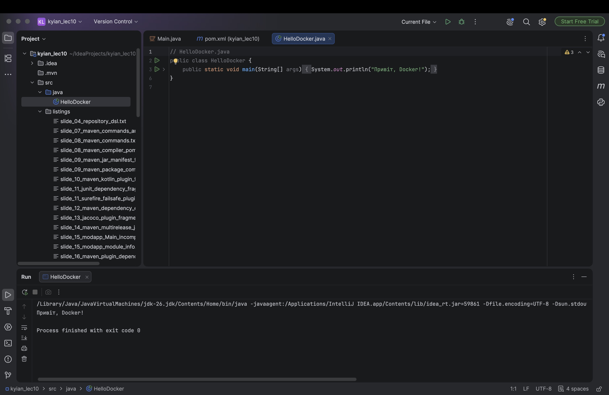
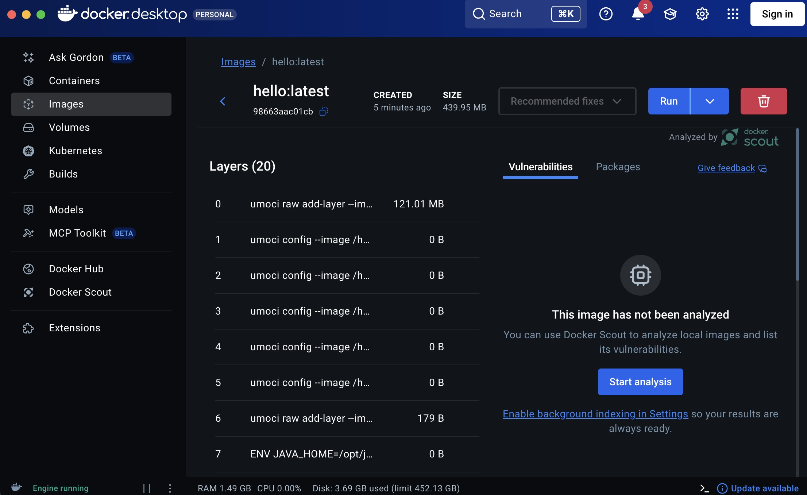
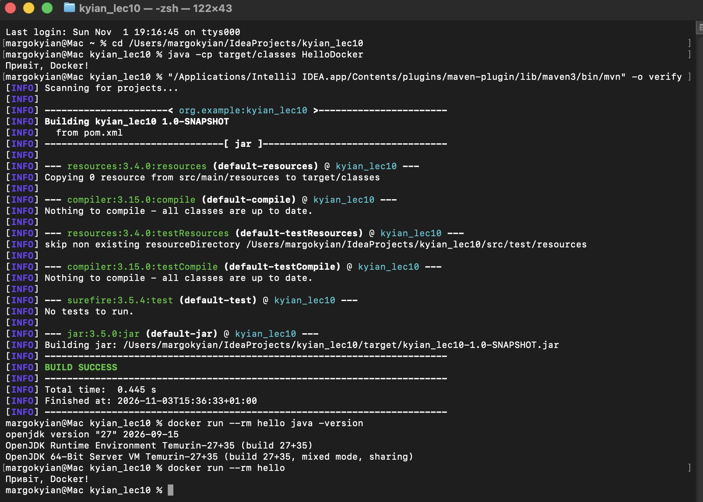

# Лекція №10
## Виконала: Киян М. ПД-31

_Примітка: всі коди з лекції збережено без змін. Деякі приклади неможливо запустити через помилки оригіналу, відсутність main() або неповноту коду, тому вони збережені у форматі .txt._

### Результат виконання завдання:

### Лістинг програмних кодів (формат .txt): [listings](src/listings)